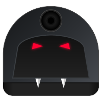

# ioBroker.vacuula

[](https://www.npmjs.com/package/iobroker.vacuula)
[](https://www.npmjs.com/package/iobroker.vacuula)


[](https://nodei.co/npm/iobroker.vacuula/)

## Vacuula Adapter for ioBroker

The adapter connects to a [Vacuula Server](https://github.com/vacuula/vacuula) via its HTTP API, discovers all Neato robots registered there and exposes their status and controls as ioBroker states. A running and reachable Vacuula server is required; the robots themselves are never contacted directly.

### Configuration

| Setting | Description |
|---|---|
| **Protocol** | `HTTP` or `HTTPS`, depending on how your Vacuula server is exposed. With HTTPS the server certificate must be valid and trusted by Node.js – self-signed certificates are not accepted. |
| **Server address** | Hostname, IPv4 or IPv6 address of the Vacuula server, optionally followed by a port. Do not enter a protocol or path. Examples: `192.168.1.10`, `vacuula.local:8080`, `[fd00::10]:8080`. IPv6 addresses must be enclosed in square brackets. |
| **Polling interval** | Interval in seconds (5–3600, default 30) at which the robot list and the state of each robot are queried. |

### Objects

`vacuula.0.info.connection` indicates whether the adapter can reach the Vacuula server. It is updated on every request, not only during polling.

Every robot reported by the server is created as a device `vacuula.0.<robotId>`. The device name is the robot's name, and its online indicator in the object view is linked to the robot's `connected` state. Robots that are no longer reported by the server are kept, but marked as disconnected. The detailed state is only queried for connected robots.

| State | Type | Writable | Description |
|---|---|---|---|
| `name` | string | – | Name of the robot as configured on the server |
| `connected` | boolean | – | Robot is connected to the Vacuula server |
| `lastUpdate` | number | – | Time of the last successful update of the robot state (`status.*`), ms since epoch |
| `status.modelName` | string | – | Model, e.g. `BotVacD7Connected` |
| `status.firmware` | string | – | Firmware version |
| `status.state` | number | – | `1` Idle, `2` Cleaning, `3` Paused, `4` Docking |
| `status.action` | number | – | Current action, e.g. `4` Docking, `9` Recovering location, `11` Cleaning, `13` Acquiring map IDs |
| `status.charge` | number | – | Battery level in % |
| `status.isCharging` | boolean | – | Robot is charging |
| `status.isDocked` | boolean | – | Robot is in its base |
| `status.dockHasBeenSeen` | boolean | – | Robot has located its base |
| `status.isScheduleEnabled` | boolean | – | Cleaning schedule is enabled on the robot |
| `status.error` | string | – | Current error reported by the robot, empty if none |
| `status.alert` | string | – | Current alert reported by the robot, empty if none |
| `status.category` | number | – | Cleaning type reported by the robot: `2` House, `3` Spot, `4` Map |
| `status.mode` | number | – | Power mode reported by the robot: `1` Eco, `2` Normal |
| `status.navigationMode` | number | – | Navigation mode reported by the robot: `1` Normal, `2` Extra Care, `3` Deep |
| `status.spotWidth` | number | – | Spot width reported by the robot in cm |
| `status.spotHeight` | number | – | Spot height reported by the robot in cm |
| `cleaningParameters.category` | number | ✓ | Cleaning type for the next start: `2` House, `3` Spot, `4` Map |
| `cleaningParameters.mode` | number | ✓ | `1` Eco, `2` Normal |
| `cleaningParameters.navigationMode` | number | ✓ | `1` Normal, `2` Extra Care, `3` Deep |
| `cleaningParameters.spotWidth` | number | ✓ | Width of the spot area in cm |
| `cleaningParameters.spotHeight` | number | ✓ | Height of the spot area in cm |
| `cleaningParameters.mapId` | string | ✓ | Map for map cleaning (`category = 4`), see `maps.<mapId>.id` |
| `cleaningParameters.boundaryId` | string | ✓ | Zone to clean for map cleaning (`category = 4`), see `maps.<mapId>.zone.<boundaryId>.id` |
| `commands.start` | button | ✓ | Start cleaning with the current `cleaningParameters.*` |
| `commands.pause` | button | ✓ | Pause cleaning |
| `commands.resume` | button | ✓ | Resume a paused cleaning |
| `commands.stop` | button | ✓ | Stop cleaning |
| `commands.findMe` | button | ✓ | Make the robot play a sound to locate it |

### Maps, blocking lines and zones

For every connected robot the maps are loaded on each polling cycle into `vacuula.0.<robotId>.maps.<mapId>`. The folder name is the map's name. For every enabled map its boundaries are loaded as well (boundaries of disabled maps are not updated): blocking lines (`polyline`) go to `…maps.<mapId>.blockingline.<boundaryId>`, zones (`polygon`) go to `…maps.<mapId>.zone.<boundaryId>`, each channel named after the boundary.

In the object IDs of maps and boundaries, every character other than `a-z`, `A-Z`, `0-9`, `_` and `-` is replaced by `-`. For example, the map `2026-11-23T13:43:47Z` is stored as `maps.2026-11-23T13-43-47Z`. The original ID is available in the `id` state.

Maps and boundaries that the server no longer reports are **not** deleted, so that history or other custom settings on their states are preserved. Delete such objects manually in the object view if you no longer need them.

| State | Type | Writable | Description |
|---|---|---|---|
| `maps.<mapId>.id` | string | – | ID of the map (e.g. for `cleaningParameters.mapId`) |
| `maps.<mapId>.name` | string | – | Name of the map |
| `maps.<mapId>.enabled` | boolean | – | Map is enabled |
| `maps.<mapId>.<blockingline\|zone>.<boundaryId>.id` | string | – | ID of the boundary |
| `maps.<mapId>.<blockingline\|zone>.<boundaryId>.color` | string | – | Color of the boundary, e.g. `#ff7a45` |
| `maps.<mapId>.blockingline.<boundaryId>.enabled` | boolean | ✓ | Blocking line is active |
| `maps.<mapId>.zone.<boundaryId>.enabled` | boolean | – | Zone is active |

When you change `enabled` of a blocking line, the adapter reloads the boundaries of that map from the server, changes only this one boundary and sends the complete list back with `setMapBoundaries`. All other boundaries stay as they are. If this fails, the state is reset to the value on the server.

### Controlling a robot

Commands are triggered by setting the corresponding `commands.*` state to `true` (without ack). The adapter sends the command to the server, resets the button to `false` and immediately refreshes the robot's state. Commands the robot cannot execute in its current situation (e.g. `resume` while not paused) are rejected by the server and logged as an error.

The `cleaningParameters.*` states are the parameters for `commands.start`. They are set only by you, never by polling. The values the robot itself reports are shown read-only under `status.category`, `status.mode`, `status.navigationMode`, `status.spotWidth` and `status.spotHeight` and are updated on every refresh.

1. Set the desired values, e.g. `cleaningParameters.category = 3`, `cleaningParameters.mode = 1`, `cleaningParameters.spotWidth = 200`, `cleaningParameters.spotHeight = 200` for a 2 × 2 m spot cleaning in eco mode.
2. Set `commands.start` to `true`.

Every value you write is checked immediately. A valid value is confirmed (ack = true) and kept for the next start; an invalid value (e.g. `cleaningParameters.mode = 7`) is rejected with a warning in the log and the previous value is restored. A parameter without a value is filled once with the value reported by the robot. The start command always sends `category`, `mode` and `navigationMode`; `spotWidth` and `spotHeight` are only sent for spot cleaning (`category = 3`). For map cleaning (`category = 4`), `mapId` and `boundaryId` are sent if they are not empty. Without `boundaryId` the whole map is cleaned. `boundaryId` requires `mapId`.

Example (JavaScript adapter):

```js
const robot = 'vacuula.0.OPS36118-f045da63f5f4';
await setStateAsync(`${robot}.cleaningParameters.category`, 2); // House
await setStateAsync(`${robot}.cleaningParameters.mode`, 2);     // Normal
await setStateAsync(`${robot}.commands.start`, true);
```

### Troubleshooting

Connection problems and failed commands are written to the ioBroker log. A persisting error is logged once as an error and then only at debug level until it is resolved, so the log is not flooded on every polling cycle. Set the instance log level to `debug` to see every request sent to the Vacuula server.

## Changelog
<!--
	Placeholder for the next version (at the beginning of the line):
	### **WORK IN PROGRESS**
-->
### **WORK IN PROGRESS**
* (muffin142) maps with their blocking lines and zones are loaded; blocking lines can be enabled/disabled
* (muffin142) map cleaning of a single zone via `cleaningParameters.mapId` / `cleaningParameters.boundaryId`
* (muffin142) polling interval is limited to 3600 s in the adapter code as well
* (muffin142) `info.modelName` and `info.firmware` moved to `status.modelName` and `status.firmware`
* (muffin142) `cleaning` renamed to `cleaningParameters`; its states are only set by the user, validated and acknowledged immediately; the values reported by the robot are mirrored read-only to `status`

### 0.0.2 (2026-11-05)
* (muffin142) enabled automated releases

### 0.0.1 (2026-11-05)
* (muffin142) initial release

## Older changes

[Older changelogs can be found there](CHANGELOG_OLD.md)

## License
MIT License

Copyright (c) 2026 muffin142 <muffin142@outlook.com>

Permission is hereby granted, free of charge, to any person obtaining a copy
of this software and associated documentation files (the "Software"), to deal
in the Software without restriction, including without limitation the rights
to use, copy, modify, merge, publish, distribute, sublicense, and/or sell
copies of the Software, and to permit persons to whom the Software is
furnished to do so, subject to the following conditions:

The above copyright notice and this permission notice shall be included in all
copies or substantial portions of the Software.

THE SOFTWARE IS PROVIDED "AS IS", WITHOUT WARRANTY OF ANY KIND, EXPRESS OR
IMPLIED, INCLUDING BUT NOT LIMITED TO THE WARRANTIES OF MERCHANTABILITY,
FITNESS FOR A PARTICULAR PURPOSE AND NONINFRINGEMENT. IN NO EVENT SHALL THE
AUTHORS OR COPYRIGHT HOLDERS BE LIABLE FOR ANY CLAIM, DAMAGES OR OTHER
LIABILITY, WHETHER IN AN ACTION OF CONTRACT, TORT OR OTHERWISE, ARISING FROM,
OUT OF OR IN CONNECTION WITH THE SOFTWARE OR THE USE OR OTHER DEALINGS IN THE
SOFTWARE.